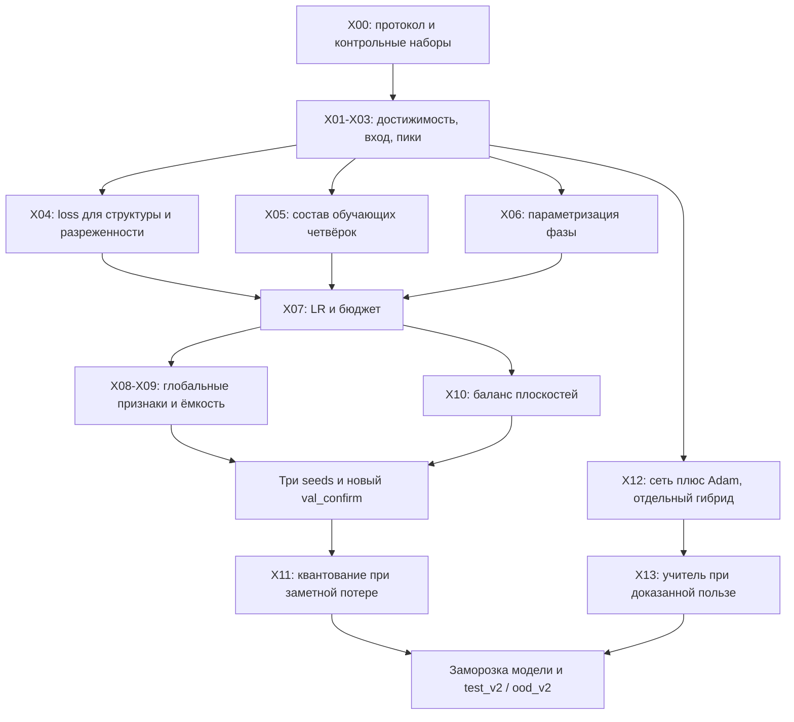

# Карта экспериментов для улучшения многоплоскостной модели

Задача **EXP-MAP**. Подготовлено по состоянию рабочей копии на 7 ноября 2026 года, ревизия `b6250d873a32ba3f368a8a1c9c935cbcb64b529a`. Ответственный за карту — coding-агент; исполнители будущих опытов — роли A/B/C из AGENTS.md. Это план следующих исследований; новые обучения в рамках анализа не запускались.

**Рекомендация:** сначала выяснить, почему сеть на разреженных целях формирует сходные пятна вместо независимых изображений, затем проверить loss, состав четвёрок и параметризацию фазы. Увеличение сети и длительности обучения имеет смысл после этих проверок. Чистый предсказатель по-прежнему должен выдавать одну фазу за один проход.

## 1. Что уже известно

Изучены AGENTS.md, PIPELINE.md, TASKS.md, README.md, RESULTS.md, B_STATUS.md, C_STATUS.md, все модули `src/`, конфигурация, профильные тесты, сводки и журналы запусков. Прочитан доступный через `read_thread` исследовательский чат: ответ с пятью статьями доступен полностью, ранний обзор обрывается в начале раздела 6. Вложенный PDF в ответе инструмента отсутствует; полного условия организаторов в репозитории также нет.

Текущая система: `PhaseUNet(16, interleave_factor=1)`, GroupNorm, три понижения разрешения, bilinear upsampling, выход `π*tanh(raw)`. Обучение через собственный одно-FFT Френель; амплитуда и нормировка по максимуму каждой плоскости. Выбранный checkpoint — шаг 1400, SHA256 `55ad50208b7545c1ea3f14485148fba089e6817d08eebfec9589eb42cb54412c`. Схема: 500 шагов MSE, затем 1500 MSE+0.1·(1−SSIM), batch 8, seed 42.

| Подтверждённый результат | Значение | Что это означает для следующего опыта |
|---|---|---|
| Validation, 64 четвёрки | SSIM 0.12606, Pearson 0.16699, худший средний SSIM плоскости 0.10873 | Исходная точка сравнения; не путать с восьмью примерами A3 |
| Test, 64 четвёрки | SSIM 0.11864, Pearson 0.14464 | Техническая работоспособность достигнута, качество ограничено |
| Test SSIM по категориям | geometry 0.01529; symbols 0.00765; grayscale 0.33797; mixed 0.11365 | Среднее сильно зависит от успеха на полутоновых узорах |
| OOD, 16 четвёрок | SSIM 0.02409, Pearson 0.08278 | Обобщение на новые формы/частоты слабое |
| Test SSIM по плоскостям | 0.14110 / 0.12096 / 0.11052 / 0.10198 | Нужно контролировать каждую глубину, особенно четвёртую |
| MSE против MSE+SSIM, равный бюджет 1000 шагов | худший средний SSIM 0.10181 → 0.10606 | Небольшой положительный результат на одном seed; стоит подтвердить |
| Interleave=4, 500 шагов MSE | 0.04033 против 0.09209 у контроля по худшему среднему SSIM | Уже отклонён в этой конфигурации; повтор не первый приоритет |
| Переобучение на четырёх четвёрках, 200 шагов | MSE 0.10344 → 0.02438; PNG SSIM 0.04382 → 0.11759 | Градиенты проходят, но убедительное запоминание изображений ещё не показано |
| Сеть против Adam на 8 val | SSIM 0.16193 / 0.14239; Pearson 0.17927 / 0.27771 | Сеть лучше по SSIM, Adam по Pearson; это не универсальное превосходство |

Источники чисел: [RESULTS.md](RESULTS.md), [MSE](runs/mvp/summary.json), [SSIM](runs/ssim/summary.json), [interleave](runs/interleave/summary.json), [переобучение](runs/diagnostics/summary.json). Сохранённый аудит сообщает 50 passed / 1 skipped; в текущем анализе suite не перезапускался: доступный `python3.12` не содержит PyTorch и остальных зависимостей проекта.

На коллажах [geometry](outputs/examples/examples_0000/collage.png) и [symbols](outputs/examples/examples_0001/collage.png) видны сходные реконструкции разных целей: яркие пятна и кольца. Это визуальное наблюдение на двух примерах, а не доказательство коллапса всей модели.

## 2. Что в коде объясняет выбор экспериментов

| Наблюдение в реализации | Следствие / проверяемая гипотеза |
|---|---|
| `TrainStream` выбирает категорию отдельно для каждой из четырёх целей; `prepare_split` для geometry/symbols/grayscale использует одну категорию на всю четвёрку | По базовым категориям train равномерен, но совместное распределение отличается от val. Вероятность четырёх целей одной конкретной базовой категории в train — `(1/3)^4=1/81`; в val на такую категорию приходится 1/4 четвёрок. Это не отсутствие символов в train, а различие сочетаний |
| `mixed` случайно выбирает одну из трёх базовых категорий | Это метка состава примера, не четвёртый самостоятельный тип изображения; нужна поканальная разметка фактических категорий |
| Grayscale — смесь синусоиды частоты 1–7 и гауссова пятна | Высокий SSIM на этой категории не подтверждает качество на фотографиях или произвольных полутонах; OOD частоты — 12–20 |
| Геометрия и текст размещаются в ограниченных диапазонах координат; используется один default font | Нужны контролируемые изменения положения, толщины, частоты и шрифта |
| `normalize_recons`: `R/amax(R)`; цели не делятся на свой максимум | У всякой ненулевой нормированной реконструкции max=1, а у многих целей max<1. Точное попиксельное совпадение таких массивов невозможно. Влияние на среднюю ошибку нужно измерить |
| Градиент проходит через `amax` | Возможно обучение стратегии с яркими пиками, уменьшающими остальную нормированную картину. Наличие такой стратегии ещё нужно проверить |
| `π*tanh(raw)` ограничивает фазу гладкой насыщаемой функцией | Возможно насыщение и нехватка высокочастотной структуры фазы; нужны измерения, а не автоматическая замена выхода |
| `baseline._loss` использует только MSE, выбранная сеть — MSE+SSIM | Нынешнее сравнение корректно описывает два готовых метода, но не отделяет влияние оптимизатора от влияния loss |
| `compare` жёстко требует 8 val, две четвёрки на категорию; гибрида нет | Для расширенных исследований понадобится отдельный runner или расширение `compare` |
| Checkpoint выбирается по худшему среднему SSIM плоскости; loss усредняет плоскости | Есть несовпадение обучаемой цели и критерия выбора |
| В журнале SSIM лучший шаг 1400; на 2000 худший средний SSIM 0.09919 при Pearson 0.18661 | Простое продолжение обучения не гарантирует улучшения критерия выбора |

Физика уже имеет независимую проверку прямым суммированием, сохранения мощности и finite differences. Её следует сохранять общей для всех методов. Проблема качества сама по себе не является основанием менять заданный оператор на ASM.

## 3. Общий протокол следующего цикла

**Неизменяемые условия:** 4×128×128 → одна фаза; λ, шаг SLM, четыре z, native выходные сетки, одинаковый экспорт `phase.png → чтение → Френель → recon PNG → чтение → метрики`. Основной режим пока amplitude/per_plane_max. Разбор amplitude/intensity — вопрос условия задачи, а не выбор более удобной метрики.

**Наборы:** существующие val и comparison_manifest использовать для разработки. Существующие test/OOD сохранить как историческую регрессию: их провалы уже изучены при проектировании новых опытов. После выбора короткого списка подготовить новый фиксированный `val_confirm` (64 четвёрки, по 16 категорий) и затем закрытые `test_v2` (64) / `ood_v2` (16). Рекомендуемые новые seeds: 43001/43002/43003. Зафиксировать manifests и хеши до запусков; внешние изображения разделять по исходникам до кропов/аугментаций. При смене генератора хранить обе версии. Если OOD-семейство включено в train, оно перестаёт быть OOD; для финала удержать другие параметры/семейства.

**Критерий:** `Q = min_k mean_samples SSIM(sample,k)` по PNG, затем средний Pearson — как сейчас. Дополнительно: все четыре плоскости, категории, худшая категория, медиана и 10-й перцентиль качества примера, число ошибок. Категорийные ограничения являются заранее объявленными условиями принятия, не скрытой заменой Q.

**Сравнение:** пилот seed 42; два лучших кандидата подтвердить seeds 42/43/44. Один фактор на опыт, одинаковые показы четвёрок и расписание validation. Для изменения loss/оптимизатора — общее исходное состояние и одинаковый поток; для архитектуры — одинаковые данные и seeds, но самостоятельная инициализация. Отдельно показывать время и число параметров. Финальные сочетания победивших факторов — отдельные опыты с удалением каждого добавленного компонента.

**Предлагаемый порог продвижения**, а не требование организаторов: пилот `ΔQ ≥ 0.005`; падение среднего Pearson или SSIM любой категории более 0.01 требует отдельного объяснения и исключает автоматическое принятие. Для исправления символов/геометрии дополнительно требовать улучшение обеих категорий, а не только среднего. На подтверждении показать среднее/разброс по трём seeds и парный bootstrap по четвёркам с сохранением четырёх плоскостей вместе; для каждой bootstrap-выборки пересчитывать Q целиком. Bootstrap одного запуска не заменяет разные seeds. Если разница неустойчива, оставить более простой вариант.

**Бюджет:** большинство пилотов — 1000 обновлений (500 MSE + 500 выбранного loss), подтверждение — 2000 при batch=8. При сравнении batch фиксировать число показанных четвёрок, не число шагов. Архитектуры также сравнивать при одинаковом времени как вторую, отдельную постановку. Логи старого Metal-запуска дают около 0.085–0.094 с на train-step, но таймер в `fit` не синхронизирует ускоритель и не включает всю генерацию/validation: это не обещание времени нового запуска. Новый бюджет измерить на 50 шагах с синхронизацией.

## 4. Карта зависимостей



Стрелки обозначают порядок принятия решений. X04/X05/X06 сравниваются по отдельности с общим контролем; одновременная смена трёх факторов не даст понять источник улучшения.

## 5. Карточки экспериментов

### X00 — согласовать протокол и заморозить контроль (P0; C, консультация A)

**Вопрос:** подтверждает ли полное условие amplitude и per-plane max? PIPELINE утверждает, что сохраняется модуль поля, а AGENTS/README честно отмечают отсутствие полного первоисточника. Источник организаторов имеет приоритет; до его появления сохранять текущий протокол и явно подписывать предположение.

**Действия:** зафиксировать baseline checkpoint, текущую ревизию и manifests, правила Q, seeds, бюджеты; выделить 8 val для диагностики. Если требуется intensity, это новая версия протокола с повторным обучением и оценкой всех методов, без прямого смешивания старых чисел.

**Готовность:** `protocol_id`, хеши и матрица опытов сохранены. **Файлы:** `config.py`, manifests, будущий `runs/experiments/<id>/config.json`; основной PNG-путь `src/io.py` сохраняется.

### X01 — отделить сложность оптимизации от достижимости (P0; A)

**Гипотеза:** часть ограничений связана с четырьмя независимыми целями, часть — с обучением сети. Существующие 100 шагов Adam и один старт не дают достаточного ориентира.

**Постановка:** на 8 диагностических val сравнить сеть и Adam при одинаковом loss. Для Adam сначала 100/300 шагов, затем 1000 на четырёх трудных случаях; до трёх стартов. MSE и MSE+0.1·(1−SSIM) — отдельные контрольные ветки. Одноплоскостную оптимизацию каждой цели сравнить с четырёхплоскостной на тех же целях: неактивные плоскости исключать из loss, не задавать им нули. Переход 1→2→4 плоскости — диагностика, не изменение итоговой задачи.

**Дополнительный контроль:** 4 небольших примера получить из заранее выбранных, уже квантованных случайных фаз через тот же propagator/PNG. Эти цели совместно достижимы по построению; сохранённая исходная фаза должна воспроизвести их PNG. Обучить сеть запоминать такие четвёрки 500–1000 шагов по физическому loss, без требования совпадения с фазой генератора. Это не датасет независимых целей и не финальная оценка.

**Решение:** если на достижимых целях сеть не приближается к исходной реконструкции, искать ограничения предсказателя/обучения; если Adam заметно сильнее сети, развивать X04/X06/X08/X13. Если все оптимизаторы слабы на независимых целях, это свидетельство трудности, но не доказательство физической невозможности или глобального оптимума. **Файлы:** `baseline.py`, `losses.py`, диагностический runner, PNG/кривые по шагам и стартам.

### X02 — проверить зависимость результата от входных целей (P0; B/C)

**Гипотеза:** сеть частично выдаёт общий шаблон, слабо учитывая содержание и канал глубины.

**Без обучения:** на 64 val подать настоящую четвёрку, другую фиксированную четвёрку и перестановки каналов. Во всех случаях оценивать выход относительно исходных целей; дополнительно оценивать переставленный вход относительно его нового порядка. Измерить падение SSIM/Pearson, попарное сходство реконструкций разных входов, дисперсию выходов. Фазы сравнивать через комплексное поле с устранением глобального фазового сдвига, а не обычной разностью углов. Отдельный постоянный вход — вспомогательный контроль вне распределения, не единственное доказательство.

**Решение:** если правильный вход не даёт устойчивого выигрыша над подменённым, начинать с X03/X04/X06 и диагностики малых обучающих наборов. Большая разница подтверждает использование входа, но не качество восстановления. **Файлы:** read-only runner над `infer.py`, `model.py`, `evaluate.py`; таблица по категориям и примерам.

### X03 — max-нормировка и яркие пики (P0; A/B)

**Гипотеза:** оптимизация через максимум допускает нежелательный компромисс «яркие пики + подавленный фон».

**Сначала измерения:** на val и четырёх фиксированных train-примерах логировать максимум цели/реконструкции, долю физической энергии `sum(|U|²)` в верхних 0.1% пикселей, ошибку внутри/вне объектов, положение максимумов и вклад градиента знаменателя нормировки. Сохранить фазу и реконструкции промежуточных шагов.

**Затем один опыт:** точная max-нормировка в forward, но `peak.detach()` в backward против нынешнего градиента; одинаковые данные и инициализация. Это суррогатный градиент, а не точная производная исходного loss. Следующий, отдельный вариант — ограниченный штраф за концентрацию энергии, если диагностика подтвердит пики. Он может навредить точечным целям, поэтому нужен контроль на точках.

**Решение:** принять только при приросте PNG-метрик и структуры, без потери корректных точек. RMS/percentile-нормировка и нормировка самих целей допускаются как отдельно подписанные диагностические протоколы, но не замена оценки, пока этого не разрешает условие. **Файлы:** `reconstruction.py`, `losses.py`, новые настройки обучения; финальный экспорт не менять.

### X04 — loss для структуры и разреженных целей (P1; B)

**Гипотеза:** усреднённая ошибка и текущая добавка SSIM недостаточно награждают восстановление символов/объектов.

**Контроль:** текущая схема 500 MSE → 500 MSE+0.1·(1−SSIM). **Варианты, последовательно:** (a) SSIM-weight 0.03/0.3 вокруг уже проверенного 0.1; (b) к выбранной базе добавить 0.05/0.1·(1−Pearson), с явной обработкой постоянных целей; (c) отдельно заменить MSE на сбалансированную ошибку объекта и фона для sparse-категорий. Например, среднее двух MSE по маске `T>0.05` и её дополнению; пустые области обрабатывать явно. Для grayscale сохранять обычный MSE, не превращать его в бинарную цель. В первом пилоте не складывать сразу все добавки.

**Бюджет:** по 1000 общих шагов для двух вариантов и контроля; дальше только победитель. **Принять:** рост Q с улучшением geometry/symbols, без существенного падения grayscale/Pearson. Считать ошибку фона и деталей дополнительной диагностикой. **Файлы:** `losses.py`, `train.py`, настройки/тесты выбранного loss. Объёмный cosine из обсуждения — резервная альтернатива Pearson; эти функции не эквивалентны.

### X05 — согласовать распределение четвёрок и расширить данные (P1; C/B)

**Гипотеза:** сеть недостаточно видит одновременно четыре разреженные или четыре текстовые цели.

**Опыт A:** сохранить существующий генератор отдельных изображений. Сравнить нынешний независимый выбор категорий по каналам с составом четвёрок как в val: 25% geometry, 25% symbols, 25% grayscale, 25% mixed. Содержимое четырёх изображений внутри категории генерировать независимо. При равном числе показов это изолирует совместное распределение.

**Опыт B после A:** отдельно расширять диапазон координат/толщин/масштабов, затем набор шрифтов, затем частотный диапазон. Удерживать новые формы и частотные интервалы для нового OOD. Реальные изображения/EMNIST/Quick, Draw!/DIV2K подключать отдельным опытом с заранее заданной долей, только если они соответствуют ожидаемым входам. Одна гладкая синусоида не заменяет фотографические текстуры.

**Бюджет:** 1000 шагов на A и контроль; 2000 для подтверждения, та же архитектура/loss. **Принять:** улучшение категорий на фиксированном val и новом подтверждающем наборе. **Файлы:** `data.py`, versioned generator config, manifests, `train.py`. Сохранять реальную категорию каждого канала и параметры генерации.

### X06 — параметризация фазового выхода (P1; B, проверка A)

**Гипотеза:** насыщение tanh и гладкий декодер ограничивают подходящие фазы.

**Диагностика:** гистограмма фазы, доля `|phi|>0.95π`, градиенты head, спектр и соседние фазовые приращения. **Один фактор:** сравнить нынешний `π*tanh(raw)` с неограниченным scalar `raw`, который физика использует в `exp(i*raw)`; вернуть wrapped-фазу `atan2(sin(raw),cos(raw))` для сохранения и контракта. Отдельно, только затем, проверить двухканальный `(a,b)` и `atan2(b,a)` с защитой от вырождения около нуля. Не клиппировать unbounded-фазу перед экспортом: требуется wrapping.

**Бюджет:** сначала 500–1000 шагов запоминания четырёх примеров, затем 1000 шагов потока. **Принять:** улучшение физического/PNG-качества без неустойчивых градиентов. Гладкая фазовая картинка не является целью сама по себе. **Файлы:** `model.py`, versioned `model_config`/загрузчик в `train.py`, проверки диапазона, градиентов и PNG.

### X07 — learning rate и достаточность обучения (P1; B)

**Гипотеза:** фиксированный lr=1e-3 мешает стабилизации Q; бюджет ещё не исследован при согласованном расписании.

**Опыт A:** после общих 500 MSE сравнить фиксированный 1e-3 и снижение до 1e-4 по одному заранее заданному расписанию, 1500 дальнейших шагов, тот же loss. **Опыт B:** только при положительной тенденции увеличить бюджет до 4000 общих шагов с неизменным расписанием; сохранить контроль 2000. Не объединять смену LR и увеличение бюджета в первый опыт.

**Решение:** продолжать при улучшении Q на фиксированном val; снижение train loss или рост одного Pearson недостаточны. Выбранный шаг 1400 и просадка Q к 2000 делают слепое продолжение слабым первым выбором. **Файлы:** `train.py`, сохранение scheduler state для resume, журналы по всем стадиям.

### X08 — глобальные и позиционные признаки (P2; B/A)

**Гипотеза:** локальным свёрткам трудно выучить нелокальное преобразование с фиксированными координатными chirp-факторами.

**Опыт A:** добавить к четырём целям фиксированные координатные каналы x/y либо фиксированные sin/cos chirp-признаки; выбрать один вариант заранее. **Опыт B отдельно:** один residual spectral-блок в bottleneck против нынешнего bottleneck, сохраняя остальную сеть. На 128×128 проверить, не слишком ли мало пространственной информации в bottleneck; при необходимости это основание для следующего опыта, не скрытого изменения текущего.

**Бюджет:** 1000 шагов пилот, 2000 подтверждение; указать параметры и latency. **Принять:** рост Q и деталей при приемлемом времени forward. Обучаемый spectral-блок находится внутри предсказателя; оператор проверки Френеля остаётся фиксированным. Это собственная архитектурная гипотеза, не буквальное воспроизведение Fourier-слоя Zeng. **Файлы:** `model.py`, `train.py`/checkpoint schema.

### X09 — ёмкость и сохранение пространственных деталей (P2; B)

**Гипотеза:** после устранения проблем обучения остаётся недостаточная ёмкость или потеря мелких признаков.

**Вариант A:** ширина 16→32, остальные компоненты фиксированы. **Вариант B отдельно:** residual conv-блоки при ширине 16. Interleave=2 рассматривать лишь при конкретных свидетельствах, что packing помогает; interleave=4 уже проиграл в коротком опыте. Отрицательный результат factor=4 не доказывает бесполезность всех перестановок, но снижает приоритет повторов.

**Бюджет:** 2000 шагов с тем же числом показов; второе сравнение — одинаковое время обучения. **Принять:** Q против числа параметров/latency, с той же проверкой категорий. **Файлы:** `model.py`, `train.py`; `--base-channels 32` уже доступен, остальные варианты требуют реализации.

### X10 — баланс четырёх плоскостей (P2; B/A)

**Гипотеза:** равные веса усреднённого loss дают слишком слабую четвёртую плоскость.

**Один вариант:** `L=(1−η)·mean_k(L_k)+η·τ·log(mean_k(exp(L_k/τ)))`, сначала η=0.25. Масштаб τ выбрать по train-loss до сравнения, например как медиану разброса `L_k` на диагностических batch, и зафиксировать. SSIM нужен отдельно по sample/plane: нынешняя функция сразу возвращает одно среднее. Не назначать веса по результатам test.

**Бюджет:** 1000 шагов против равных весов, затем подтверждение. **Принять:** улучшение Q без разрушения первых плоскостей и без превышения категорийных ограничений. **Файлы:** `losses.py`, `train.py`, журнал `loss_k`, SSIM/Pearson каждой глубины.

### X11 — учёт 8-битного квантования (P3, условный; A/B/C)

**Сначала без обучения:** на 64 val измерить разницу между float-фазой, квантованной фазой с float-реконструкциями и полным PNG-путём. Дополнительные float-метрики подписать; главным остаётся PNG.

**Условие запуска:** если потеря Q после квантования фазы сопоставима с целевым приростом 0.005, сравнить короткое дообучение с fake quantization/STE и контроль той же длительности без STE. Сетка — ровно 255 интервалов между −π/+π, как сейчас. **Бюджет:** 500 дополнительных шагов каждой ветки. **Принять:** прирост PNG-Q; уменьшение float-ошибки само по себе не считается. Если разрыв мал, опыт отложить. **Файлы:** `losses.py`/train objective; `io.py` сохраняет текущую формулу.

### X12 — проверить пользу сети как инициализации Adam (P1 для гибрида; A)

**Гипотеза:** старт сети позволяет быстрее прийти к более качественной маске.

**Матрица:** чистая сеть; сеть+10/50 шагов; случайная фаза+10/50 шагов; случайная фаза+100/300 шагов как более дорогой ориентир. Для пар 10/50 одинаковы loss, lr и критерий выбора результата; отдельно показывать MSE и MSE+SSIM, если оба исследуются. Нынешний `optimize_phase(initial_phase=...)` уже поддерживает сетевую инициализацию, но общий runner и выбор objective нужно добавить.

**Бюджет:** сначала 8 val, победивший вариант — 64 val, три random seeds. Сравнить и равное число шагов, и равное полное время с учётом forward сети. Выбор лучшего старта делать по заранее заданному физическому objective; учитывать суммарную стоимость всех стартов.

**Принять:** преимущество инициализации на кривой качество–время. Это отдельный гибрид с итерациями при инференсе; метрики и latency чистой сети сохранять отдельно. При строгом требовании одного прохода гибрид служит только диагностикой/учителем. **Файлы:** `baseline.py`, `compare.py`, runner, метаданные числа FFT/шагов.

### X13 — обучение по решениям сильного оптимизатора (P3, условный; A/B/C)

**Запускать, если** X01/X12 показывают ощутимый разрыв между оптимизированными фазами и сетью. Сначала 128–256 train-четвёрок с учителем 300 шагов/до трёх стартов; учителя validation/test не использовать для обучения. Сохранить реальные затраты генерации, выбранные старты, цель и полученное качество. Если учитель слаб на символах, массовое копирование этих фаз не решает проблему.

**Контроль:** тот же предсказатель и число train-обновлений с одним физическим loss. **Кандидат:** предварительное обучение с периодическим фазовым сходством, инвариантным к глобальной фазе, затем тот же физический loss. Например, `L_phase=1−|mean_pixels(exp(i·(phi_pred−phi_teacher)))|`; не использовать обычный MSE по углам. Даже такой loss устраняет лишь глобальную фазовую неоднозначность, а не все возможные эквивалентные решения; проверять конечные реконструкции.

**Принять:** улучшение Q чистой сети и разумная суммарная стоимость. Более крупный набор 1000+ учителей делать только после пилота. **Файлы:** `data.py`, `losses.py`, `train.py`, отдельный train-manifest учителей. Это supervised/hybrid training, а не прежнее обучение без фазовых меток.

## 6. Очередь для трёх участников

| Этап | A: физика и оптимизация | B: сеть и обучение | C: данные и интеграция | Решение на выходе |
|---|---|---|---|---|
| 0 | Уточнение протокола X00 | Зафиксировать checkpoint/инициализацию | X00: manifests и таблица опытов | Сравнения совместимы |
| 1 | X01: Adam и достижимые цели | X02: зависимость от входа | X02: сводка категорий/изображений | Обучение, данные или трудность целей? |
| 2 | X03: пики/нормировка | X04: один loss-кандидат за запуск | X05: подготовить sampler и метаданные | Подтверждена причина и первый прирост |
| 3 | X12: гибрид, отдельная ветка | X05, затем X06 по одному | Протокол сравнения и аудит артефактов | Выбран лучший простой предсказатель |
| 4 | Проверка совместимости/квантования | X07, затем X08/X09/X10 по показаниям | Новый val_confirm и сводки | Подтверждение на трёх seeds |
| 5 | Контроль baseline и времени | Заморозка модели; X13 только при основании | Финальные test_v2/OOD_v2 и PNG-аудит | Воспроизводимый новый результат |

У каждого участника одновременно одна основная задача; при одном GPU его использует B. Задачи A/C преимущественно CPU. Первый ограниченный цикл: X00–X03, затем X04 и X05 по одному кандидату с контролем, после чего X06 при выявленных проблемах фазы. X08–X13 не обязательны для первого цикла.

## 7. Что уже можно запускать и что нужно дописать

Существующий CLI поддерживает MSE/SSIM-weight, ширину, interleave, lr, overfit и resume. Новые режимы sampler, Pearson/foreground loss, phase head, scheduler, worst-plane loss, fake quantization, teacher training и гибридный отчёт пока не реализованы. Карточки не следует читать как описание уже существующих флагов.

Пример независимого контроля с сохранением MVP-весов (в подготовленном окружении проекта):

```bash
python -m src.train --steps 500 --batch-size 8 --seed 42 --device auto --checkpoint-dir checkpoints/experiments/control42 --run-dir runs/experiments/control42
python -m src.train --resume checkpoints/experiments/control42/last.pt --steps 500 --batch-size 8 --seed 42 --device auto --ssim-weight 0.1 --checkpoint-dir checkpoints/experiments/control42 --run-dir runs/experiments/control42
```

Для ветвления скопировать общий checkpoint шага 500 **до** продолжения: иначе `last.pt` будет перезаписан. `best.pt` содержит выбранную модель, но в текущем CLI сохраняется без optimizer state; для resume использовать `last.pt`. `--steps` при resume означает дополнительные обновления. Каждый seed/кандидат — отдельные каталоги; финальные `checkpoints/best.pt` и старые результаты сохранять.

Перед серией нужны небольшие изменения исследовательской инфраструктуры:

- Общий objective для сети/Adam/гибрида, с явным названием и весами в отчёте; существующий MSE-baseline сохранить как контроль.
- Вектор метрик/loss по sample и plane; diagnostics пиков, насыщения и квантования; расширение сравнения за пределы жёстких восьми примеров.
- Append-only сведения о стадиях обучения: родительский checkpoint/hash, sampler/generator version, loss/architecture config, optimizer/scheduler/RNG. Сейчас `config.json` перезаписывается при resume и один не описывает всю историю; существующие summaries дополняют его вручную.
- При новых архитектурах расширить checkpoint schema и загрузчик: сейчас поддерживаются только base_channels/interleave_factor.
- Аккуратная генерация новых splits: `src.data.main` даже при `--root` пишет examples относительно текущего каталога. Не использовать эту команду для нового набора без исправления этого побочного эффекта или отдельного runner; старые examples/manifests сохранять.
- Синхронизировать ускоритель для честного train/forward timing; раздельно сохранять подготовку данных, обучение, validation и экспорт. Выполнять существующие проверки после изменения соответствующих модулей; для итогового кандидата — полный suite и PNG-аудит.

Артефакты опыта: config/protocol/manifests hashes, parent checkpoint, seed, показы/шаги, train/val history, initial/best/last weights, per-sample PNG-метрики, категории/плоскости, качество–время, ошибки и решение «принят/отклонён/недостаточно данных». Новые крупные обучения в рамках этой карты не выполнялись.

## 8. Связь с исследованием и публикациями

Из [исследовательского чата](chatgpt-conversation://6aee05cd-bb3c-83eb-8182-cb4c26697bf5) сохраняется основная комбинация U-Net + обучение через реконструкции + дифференцируемая оптика. Важные поправки: ранний обзор использовал интенсивность, тогда как рабочий протокол проекта — амплитуда; термин «Fourier-layer» не означает, что стоит обучать или заменять оператор проверки.

| Источник | Основание для карты | Граница переноса |
|---|---|---|
| [Zeng 2026](https://www.mdpi.com/2304-6732/13/3/252) | Многоплоскостная U-Net и физический критерий; X04/X08/X09 | Линзовая Fourier-постановка статьи отличается от нашего Френеля. Полный текст при этой проверке недоступен из-за HTTP 429; использованы индексируемый текст первичного источника и полностью доступный обзор пяти статей. Точные детали loss/обучения здесь не объявляются воспроизведёнными |
| [DeepCGH, официальный код](https://github.com/UNC-optics/DeepCGH), [статья](https://doi.org/10.1364/OE.399624) | Обучение через оптику без обязательной фазы учителя, синтетические точки/линии/диски; X01/X05 | Сохраняем собственную PyTorch-физику и независимые цели |
| [Peng 2020, страница авторов](https://www.computationalimaging.org/publications/neuralholography/) | Оптимизация голограммы и компромисс качества/времени; X01/X12 | CITL, аппаратную калибровку и чужой propagator не переносим |
| [Yan 2025, полный текст](https://pmc.ncbi.nlm.nih.gov/articles/PMC11848602/) | Разнообразие 2D-данных и распределений по глубинам; X05 | Виртуальная глубина и ASM статьи не равны четырём независимым целям |
| [Yan 2024, полный текст](https://pmc.ncbi.nlm.nih.gov/articles/PMC11267294/) | FCN на комплексных дифракционных признаках — основание рассмотреть физические признаки после простых контролей | Это тоже U-Net-based FCN, а не автоматически принципиально новая сеть; occlusion/forward–backward сцен не нужны для основной задачи |

Составы данных, конкретные веса loss, пороги продвижения, бюджет, координатные признаки, stop-gradient и порядок опытов выше — предложения для данного проекта, не результаты этих статей. Результаты статей по другим сеткам и оптике не являются целевыми числами нашей оценки.

GS оставить резервным сравнением после сильного Adam; unrolled optimization — отдельным методом после X12/X13. GAN, диффузия, увеличение разрешения, RGB, многофреймовость и реальная установка не входят в эту очередь улучшений.
