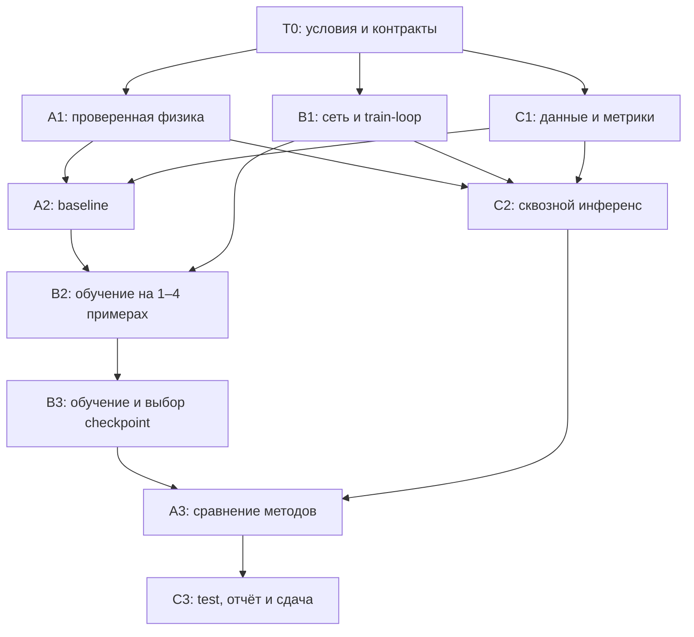

# TASKS — реализация MVP командой из трёх человек

Статус B: B1–B3 завершены, финальный checkpoint проверен; [B_STATUS.md](B_STATUS.md).

Статус C: T0.1 и C1 завершены; C2 проверен на реальном Френеле и initial.pt; C3 ожидает обученный best.pt и A3. Подробности: [C_STATUS.md](C_STATUS.md). Правила, физические параметры, API и протокол оценки: [AGENTS.md](AGENTS.md). Исходный календарный план: [PIPELINE.md](PIPELINE.md).

Работу делим по модулям. **Zeng → архитектура B; DeepCGH → обучение B через оптическое восстановление; Peng → физика и baseline A.** C обеспечивает данные, проверку результатов и сдачу. Это адаптация идей статей к заданному одно-FFT Френелю, а не точное воспроизведение публикаций.

## Как пользоваться планом

- Назначить реальных участников на роли A/B/C. Каждый берёт одну доступную подзадачу, отмечает начало, затем закрывает её по критерию готовности.
- ID до точки соответствует крупному блоку из AGENTS: например, `A1.2` входит в A1. Подзадача доступна после завершения всех её зависимостей.
- Таблицы ниже задают обязательный минимум. Чекбоксы закрываются после проверки; время — оценка активной работы, отдельно от обучения и ожидания.
- К закрытой задаче приложить файлы, команду/способ проверки, краткий результат и ограничения. Численные результаты не заполнять вымышленными значениями.
- Незавершённую задачу с блокером передавать с причиной и следующим проверяемым действием; при этом продолжать доступную независимую работу.

Цель: начать обучение к третьему часу и собрать проверенный MVP за 7–9 часов; жёсткий предел — 24 часа. Отсчёт начинается в T0. Не суммировать трудозатраты трёх участников как календарное время.

## T0 — общий старт, 15–20 минут

| Готово | ID | Владелец | Работа / файлы | Зависимости | Критерий готовности | Время |
|---|---|---|---|---|---|---|
| [x] | **T0.1** | C | Каркас пакета `src/`, `tests/`, минимальные `requirements.txt` и README | Нет | Среда запускает Python и импорт PyTorch; согласованы пути и запуск `python -m src.…` | 5 мин |
| [x] | **T0.2** | A | Начальная конфигурация в `config.py` | T0.1 | Параметры сверены с AGENTS; `CONFIG.snapshot()` проходит JSON round-trip | 5–10 мин |
| [x] | **T0.3** | B | Проверка устройства и комплексного autograd | T0.1 | PyTorch 2.15.0: CPU и Metal прошли FFT/backward; полный путь U-Net → 4 Френеля → loss даёт конечный ненулевой градиент на Metal | 5–10 мин |
| [ ] | **T0.4** | C, с A/B | Соглашения в README | T0.2, T0.3 | Записаны участники, старт/дедлайн, протокол, seed, выбор checkpoint и открытый вопрос `abs(U)`/`abs(U)**2` | 5 мин |

T0.2 и T0.3 выполняются одновременно. До проверки полного кейса использовать `amplitude` как явно помеченное предположение из AGENTS. Этот вопрос не блокирует независимые модули; смена режима требует повторного обучения/оценки.

## A — физика и классическая оптимизация

Основной референс — Peng; комплексный оператор Френеля реализовать под параметры кейса. Владелец `config.py`, `src/{physics,reconstruction,baseline}.py`, `tests/test_physics.py`.

| Готово | ID | Работа / результат | Зависимости | Критерий готовности | Время |
|---|---|---|---|---|---|
| [x] | **A1.1** | Центрированные сетки и фазовые множители | T0.4 | Проверены четыре шага `dx_out = λz/(N dx_in)` | 15–20 мин |
| [x] | **A1.2** | `fresnel_1fft` в `src/physics.py` | A1.1 | Один центрированный FFT на плоскость; проверены масштаб, глобальная фаза и комплексный выход | 20 мин |
| [x] | **A1.3** | `propagate_four`, `reconstruct_four`, `normalize_recons` | A1.2 | В `src.reconstruction` проверены амплитуда, интенсивность и независимая нормировка плоскостей | 15–20 мин |
| [x] | **A1.4** | Независимая проверка физики и autograd | A1.3 | `python -m pytest tests/test_physics.py -q`: 6 проверок, включая прямую сумму, мощность и конечные разности | 20–30 мин |
| [x] | **A2.1** | `optimize_phase` через Adam | A1.4, C1.4 | `python -m pytest tests/test_baseline.py -q`: 3 проверки, включая снижение MSE и воспроизводимость старта | 15–20 мин |
| [x] | **A2.2** | CLI `python -m src.baseline` и общий PNG-экспорт | A2.1 | CPU, 100 шагов, seed 42: MSE четырёх плоскостей `val_0000` 0.09835 → 0.01752, `val_0001` 0.09315 → 0.00663; только первая плоскость `val_0000` (`--plane 1`) 0.10681 → 0.03975 | 15–25 мин |
| [x] | **A3.1** | Сравнение начальной сети, обученной сети и Adam | A2.2, B3.2, C2.2 | 8 validation-четвёрок; 32 валидных пары на метод, метрики перепроверены по сохранённым PNG | 20–25 мин |
| [x] | **A3.2** | Измерение времени и описание ограничений | A3.1 | На одном CPU замерены forward, Adam и полный путь с PNG-экспортом; параметры и результаты ниже | 10–15 мин |

**Передача A1:** B получает импортируемые функции с рабочим backward; C — те же функции реконструкции и нормировки. Прохождение простого smoke-test не заменяет A1.4. Допуски и физические инварианты — в AGENTS, раздел 8.

**Передача A2:** baseline обязателен минимум на двух четвёрках. Желательно заранее выбрать восемь validation-четвёрок, по две на категорию, для сравнения A3. Использовать тот же режим, нормировку, квантование и метрики, что у сети; не считать Adam доказанным глобальным оптимумом.

**Результаты A3.** [Сводка JSON](outputs/comparison/a_summary.json) содержит метрики по плоскостям, времена и SHA256 checkpoint. Общие входы зафиксированы в [манифесте C](data/val/comparison_manifest.json). Все реконструкции рассчитаны из сохранённой 8-битной фазы. Adam минимизирует `mean((R / max(max(R), 1e-8) - T)^2)`, где `R = abs(U_z)` и максимум берётся по пикселям каждой плоскости. Идея прямой градиентной оптимизации фазы следует [Peng et al., 2020](https://doi.org/10.1145/3414685.3417802).

| Метод | Pearson / SSIM по плоскостям 1–4 | Среднее Pearson / SSIM | Худшее среднее Pearson / SSIM | Расчёт / с PNG, мс |
|---|---|---|---|---|
| Начальная сеть | .191/.108 · .088/.041 · .112/.054 · .097/.035 | .122/.060 | .088/.035 | 54 / 199 |
| Обученная сеть, шаг 1400 | .233/.198 · .193/.176 · .187/.156 · .103/.118 | .179/.162 | .103/.118 | 54 / 185 |
| Adam по фазе, 100 шагов | .360/.157 · .316/.157 · .239/.149 · .199/.112 | .278/.144 | .199/.112 | 2326 / 2479 |

Времена — медиана по восьми примерам на AMD Ryzen 5 3500U, CPU, два потока, PyTorch 2.15.0+cpu. Перед замером — два forward или два шага Adam. У Adam один случайный старт с seed 42 и `lr=0.1`. Сеть выше по SSIM на всех четырёх плоскостях, Adam выше по Pearson. Значения относятся к подвыборке validation, которая входит в набор выбора checkpoint. Итоговую оценку обобщения на test/OOD ведёт C.

```bash
python -m src.compare --out outputs/comparison/repro --device cpu --threads 2 --steps 100 --seed 42
```

## B — нейросеть и обучение

Zeng задаёт архитектурную основу U-Net; DeepCGH — схему обновления весов через оптическое восстановление. Владелец `src/{model,losses,train}.py`, `checkpoints/`, `runs/`.

| Готово | ID | Работа / результат | Зависимости | Критерий готовности | Время |
|---|---|---|---|---|---|
| [x] | **B1.1** | Компактная U-Net в `src/model.py` | T0.4 | `PhaseUNet(16)`: 4→1, `π*tanh(raw)`; 6 тестов формы, градиентов и изоляции batch прошли (`tests/test_model.py`) | 20–25 мин |
| [x] | **B1.2** | MSE по четырём плоскостям в `src/losses.py` | B1.1 | `physics_loss` подключает нормировку A; 4 теста равных весов, autograd и запрета broadcasting прошли (`tests/test_losses.py`) | 10–15 мин |
| [x] | **B1.3** | Каркас train-loop и CLI | B1.2 | `src.train`: Adam, CLI, seed, JSONL, finite-check, атомарный last checkpoint; 4 теста обучения/NaN/прерывания прошли (`tests/test_train.py`) | 20–25 мин |
| [x] | **B1.4** | Checkpoint и контроль начального состояния | B1.3 | `initial.pt`, `load_checkpoint`, optimizer/RNG resume; 4 теста точного восстановления, протокола и продолжения Adam прошли (`tests/test_checkpoint.py`) | 10–15 мин |
| [x] | **B2.1** | Подключение реального физического оператора | B1.4, A2.2, C1.4 | 20 шагов Metal без NaN; MSE CPU-проверки 0.12327→0.04501, градиенты ненулевые; `runs/diagnostics/summary.json`, 6 train-тестов прошли | 10–15 мин |
| [x] | **B2.2** | Диагностическое переобучение | B2.1 | 200 шагов на 4 train-четвёрках; MSE 0.10344→0.02438, PNG SSIM 0.04382→0.11759, 16/16 валидных пар; `runs/diagnostics/{summary.json,overfit.png}` | 20–30 мин |
| [x] | **B3.1** | Потоковый train и фиксированная validation | B2.2 | 500 шагов, 4000 показов, 64 val; лучший шаг 450, средний SSIM 0.04731→0.10452; логи `runs/mvp/`, веса `checkpoints/pilot_best.pt` | 25–45 мин + обучение |
| [x] | **B3.2** | Выбор, проверка и фиксация `best.pt` | B3.1 | Бюджет 2000 шагов, выбран шаг 1400; CPU val SSIM 0.12606/Pearson 0.16699, 256/256 пар; 50 тестов и trained CLI прошли; `runs/ssim/summary.json` | 20–45 мин + обучение |

До A1.3 проверять B1.2/B1.3 на явно обозначенной локальной заглушке того же интерфейса. При готовности A импортировать его функции без копирования. Физическое обучение начинается только в B2.1 после независимой проверки A и диагностического baseline.

Фиксированные 1–4 примера для B2.2 — диагностическая train-подвыборка, отдельно от validation/test/OOD. Если она не обучается, проверить градиенты, нормировку, физику и выход сети до расширения датасета.

**Передача B1:** `initial.pt` — необученная сеть (step=0) с протоколом A. Загрузка: `from src.train import load_checkpoint, current_protocol`, затем `model, metadata = load_checkpoint(path, device="cpu", expected_protocol=current_protocol())`. **Передача B3:** замороженный `checkpoints/best.pt`, конфигурация и validation. Результаты/команды — [B_STATUS.md](B_STATUS.md); A3/C3 разблокированы.

## C — данные, интеграция и сдача

Для подготовки 2D-целей использовать идеи Yan 2025 с независимым выбором четырёх изображений. Владелец `src/{data,io,evaluate,infer}.py`, `tests/test_io.py`, README, зависимостей, данных и выходных каталогов.

| Готово | ID | Работа / результат | Зависимости | Критерий готовности | Время |
|---|---|---|---|---|---|
| [x] | **C1.1** | Входные PNG и кодирование фазы в `src/io.py` | T0.4 | Порядок четырёх файлов фиксирован; размер/режим проверяются; phase PNG корректно читается обратно в радианы | 15–20 мин |
| [x] | **C1.2** | Потоковый генератор и `make_train_loader` | C1.1 | Независимые цели, формы/символы/полутона; воспроизводимый RNG без сброса на каждом batch; есть диагностическая train-подвыборка | 20–25 мин |
| [x] | **C1.3** | Фиксированные наборы и manifests | C1.2 | 64 val, 64 test, 16 OOD, 4–8 examples; seed/источники/хеши/порядок z сохранены; нет утечки исходников | 20–25 мин |
| [x] | **C1.4** | Pearson/SSIM и общий экспорт результатов | C1.3 | Известные пары дают ожидаемые значения; постоянные случаи обработаны; PNG перечитываются для метрик; JSON без NaN/Infinity | 15–20 мин |
| [x] | **C2.1** | CLI `src.infer` | C1.4, A1.4, B1.4 | Одна команда: четыре входных PNG + checkpoint → phase, четыре recon и metrics.json | 20–25 мин |
| [x] | **C2.2** | Проверка полного сохранения и повторного чтения | C2.1 | Реконструкции рассчитаны из сохранённой фазы, метрики — по сохранённым recon PNG; повторный запуск воспроизводит результат | 10–20 мин |
| [ ] | **C3.1** | Финальная оценка test/OOD через `src.evaluate` | C2.2, B3.2, A3.2 | Зафиксированный checkpoint оценён на всех 64 test + 16 OOD; показаны категории, плоскости, ошибки и размер каждого сравнения | 20–30 мин |
| [ ] | **C3.2** | README и пакет сдачи | C3.1 | Установка, реальные команды, метод, предположения, метрики, данные/генератор, checkpoint и ограничения собраны | 15–20 мин |
| [ ] | **C3.3** | Финальный воспроизводимый запуск | C3.2 | Запуск по README в новом выходном каталоге; A проверил физику, B — загрузку модели; файлы и метрики совпали | 10 мин |

**Передача C1:** B получает train-loader и фиксированную validation; A — диагностические цели, IO и метрики. Test/OOD сохраняются заранее, но не используются для выбора модели. C1.4 готовится на искусственных массивах, поэтому ожидание физики его не блокирует.

**Передача C2:** рабочая команда инференса доступна ещё с `initial.pt`; это техническая проверка. **Передача C3:** итоговая таблица отдельно показывает обученную сеть, начальную сеть и baseline на общей подвыборке; для каждого набора указан фактический объём.

## Порядок интеграции



Первый сквозной запуск C2 идёт параллельно B2 и не ожидает хорошего качества. A может подготовить запуск сравнения и таблицу во время B3; итоговые числа A3 получает после фиксации checkpoint.

| Контрольная точка | Что предъявить |
|---|---|
| После T0 | README с соглашениями, конфигурация, результат проверки устройства |
| Около 2-го часа | Модули A1/B1/C1 и результаты их локальных проверок |
| Около 3-го часа | Сквозной запуск, диагностический baseline, начало реального обучения |
| Около 5–6-го часа | Рабочий checkpoint и логи validation; архитектура зафиксирована |
| К 7–9-му часу | Test/OOD, сравнение, PNG, checkpoint и воспроизводимая инструкция |

Если A1.4 не проходит, чинить физику; B/C продолжают свои независимые части. Если B2.2 не показывает улучшения, диагностировать конвейер. Если B3 не даёт качества, сохранить честный результат и baseline, не выдавая baseline за выход сети. После рабочего пакета резерв использовать для обучения и исправления ошибок.

## После обязательного MVP

Эти задачи не блокируют C3.3; запускать по одной, если остаётся время. Если улучшение принято, повторить сравнение и финальную проверку; после подбора на test потребуется новый test.

| ID | Владелец | Эксперимент | Критерий принятия |
|---|---|---|---|
| **O1** | B | MSE + 0.1·(1−SSIM) | Принят при равном бюджете 1000 шагов: худший средний SSIM 0.10606 против 0.10181; затем выбранный вариант продолжен до бюджета 2000 |
| **O2** | A/B | Сеть + 50 шагов Adam против случайной фазы + 50 шагов | Измерена польза инициализации; качество и время чистой сети показаны отдельно |
| **O3** | B | Interleave=4, 500 шагов при том же MSE | Отклонён: худший средний SSIM 0.04033 против 0.09209 у обычной сети; `runs/interleave/summary.json` |

GS и альтернативная FCN Yan 2024 остаются дальнейшими направлениями. Предварительное обучение по эталонным фазам не входит в обязательную реализацию.

## Первые задачи для выдачи участникам

- **A:** после T0 взять `A1.1 → A1.2 → A1.3 → A1.4`. Передать проверенный оператор и общую нормировку B/C, затем перейти к A2.
- **B:** после T0 взять `B1.1 → B1.2 → B1.3 → B1.4`. Передать C начальный checkpoint; дождаться A2.2 для B2 и запустить обучение.
- **C:** организовать T0, затем `C1.1 → C1.2 → C1.3 → C1.4`. Передать данные/метрики A/B и собрать C2, пока B обучает сеть.

MVP завершён после C3.3 и проверки критериев AGENTS. Техническая готовность и подтверждённое качество отмечаются раздельно.
