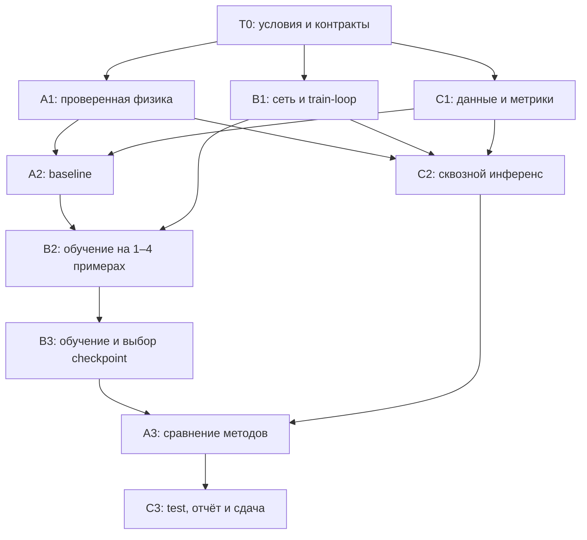

# TASKS — реализация MVP командой из трёх человек

Статус C: T0.1 и C1 завершены; код C2 подготовлен, сквозная проверка ожидает A/B. Подробности: [C_STATUS.md](C_STATUS.md). Правила, физические параметры, API и протокол оценки: [AGENTS.md](AGENTS.md). Исходный календарный план: [PIPELINE.md](PIPELINE.md).

Работу делим по модулям. **Zeng → архитектура B; DeepCGH → обучение B через оптическое восстановление; Peng → физика и baseline A.** C обеспечивает данные, проверку результатов и сдачу. Это адаптация идей статей к заданному одно-FFT Френелю, а не точное воспроизведение публикаций.

## Как пользоваться планом

- Назначить реальных участников на роли A/B/C. Каждый берёт одну доступную подзадачу, отмечает начало, затем закрывает её по критерию готовности.
- ID до точки соответствует крупному блоку из AGENTS: например, `A1.2` входит в A1. Подзадача доступна после завершения всех её зависимостей.
- Таблицы ниже задают обязательный минимум. Все чекбоксы изначально открыты; время — оценка активной работы, отдельно от обучения и ожидания.
- К закрытой задаче приложить файлы, команду/способ проверки, краткий результат и ограничения. Численные результаты не заполнять вымышленными значениями.
- Незавершённую задачу с блокером передавать с причиной и следующим проверяемым действием; при этом продолжать доступную независимую работу.

Цель: начать обучение к третьему часу и собрать проверенный MVP за 7–9 часов; жёсткий предел — 24 часа. Отсчёт начинается в T0. Не суммировать трудозатраты трёх участников как календарное время.

## T0 — общий старт, 15–20 минут

| Готово | ID | Владелец | Работа / файлы | Зависимости | Критерий готовности | Время |
|---|---|---|---|---|---|---|
| [x] | **T0.1** | C | Каркас пакета `src/`, `tests/`, минимальные `requirements.txt` и README | Нет | Среда запускает Python и импорт PyTorch; согласованы пути и запуск `python -m src.…` | 5 мин |
| [x] | **T0.2** | A | Начальная конфигурация в `config.py` | T0.1 | Параметры сверены с AGENTS; `CONFIG.snapshot()` проходит JSON round-trip | 5–10 мин |
| [x] | **T0.3** | B | Проверка устройства и комплексного autograd | T0.1 | PyTorch 2.15.0: CPU и Metal прошли FFT/backward; полный путь U-Net → 4 Френеля → loss даёт конечный ненулевой градиент на Metal | 5–10 мин |
| [ ] | **T0.4** | C, с A/B | Соглашения в README | T0.2, T0.3 | Записаны участники, старт/дедлайн, протокол, seed, выбор checkpoint и открытый вопрос `abs(U)`/`abs(U)**2` | 5 мин |

T0.2 и T0.3 выполняются одновременно. До проверки полного кейса использовать `amplitude` как явно помеченное предположение из AGENTS. Этот вопрос не блокирует независимые модули; смена режима требует повторного обучения/оценки.

## A — физика и классическая оптимизация

Основной референс — Peng; комплексный оператор Френеля реализовать под параметры кейса. Владелец `config.py`, `src/{physics,reconstruction,baseline}.py`, `tests/test_physics.py`.

| Готово | ID | Работа / результат | Зависимости | Критерий готовности | Время |
|---|---|---|---|---|---|
| [x] | **A1.1** | Центрированные сетки и фазовые множители | T0.4 | Проверены четыре шага `dx_out = λz/(N dx_in)` | 15–20 мин |
| [x] | **A1.2** | `fresnel_1fft` в `src/physics.py` | A1.1 | Один центрированный FFT на плоскость; проверены масштаб, глобальная фаза и комплексный выход | 20 мин |
| [x] | **A1.3** | `propagate_four`, `reconstruct_four`, `normalize_recons` | A1.2 | В `src.reconstruction` проверены амплитуда, интенсивность и независимая нормировка плоскостей | 15–20 мин |
| [x] | **A1.4** | Независимая проверка физики и autograd | A1.3 | `python -m pytest tests/test_physics.py -q`: 6 проверок, включая прямую сумму, мощность и конечные разности | 20–30 мин |
| [ ] | **A2.1** | `optimize_phase` через Adam | A1.4, C1.4 | Оптимизируется сама фаза без сети; поддержаны случайный старт и `initial_phase`; на диагностических целях loss уменьшается | 15–20 мин |
| [ ] | **A2.2** | CLI baseline и сохранение результатов | A2.1 | На одной и четырёх плоскостях выполнены 100–300 шагов; фаза, PNG, метрики, seed и время сохранены общим путём экспорта | 15–25 мин |
| [ ] | **A3.1** | Сравнение начальной сети, обученной сети и Adam | A2.2, B3.2, C2.2 | Одинаковые заранее выбранные цели и PNG-протокол; таблица качества каждой плоскости, среднего и худшего среднего | 20–25 мин |
| [ ] | **A3.2** | Измерение времени и описание ограничений | A3.1 | Раздельно указаны forward сети и итерационный baseline; есть устройство, прогрев, синхронизация ускорителя и фактические бюджеты | 10–15 мин |

**Передача A1:** B получает импортируемые функции с рабочим backward; C — те же функции реконструкции и нормировки. Прохождение простого smoke-test не заменяет A1.4. Допуски и физические инварианты — в AGENTS, раздел 8.

**Передача A2:** baseline обязателен минимум на двух четвёрках. Желательно заранее выбрать восемь validation-четвёрок, по две на категорию, для сравнения A3. Использовать тот же режим, нормировку, квантование и метрики, что у сети; не считать Adam доказанным глобальным оптимумом.

## B — нейросеть и обучение

Zeng задаёт архитектурную основу U-Net; DeepCGH — схему обновления весов через оптическое восстановление. Владелец `src/{model,losses,train}.py`, `checkpoints/`, `runs/`.

| Готово | ID | Работа / результат | Зависимости | Критерий готовности | Время |
|---|---|---|---|---|---|
| [x] | **B1.1** | Компактная U-Net в `src/model.py` | T0.4 | `PhaseUNet(16)`: 4→1, `π*tanh(raw)`; 6 тестов формы, градиентов и изоляции batch прошли (`tests/test_model.py`) | 20–25 мин |
| [x] | **B1.2** | MSE по четырём плоскостям в `src/losses.py` | B1.1 | `physics_loss` подключает нормировку A; 4 теста равных весов, autograd и запрета broadcasting прошли (`tests/test_losses.py`) | 10–15 мин |
| [x] | **B1.3** | Каркас train-loop и CLI | B1.2 | `src.train`: Adam, CLI, seed, JSONL, finite-check, атомарный last checkpoint; 4 теста обучения/NaN/прерывания прошли (`tests/test_train.py`) | 20–25 мин |
| [x] | **B1.4** | Checkpoint и контроль начального состояния | B1.3 | `initial.pt`, `load_checkpoint`, optimizer/RNG resume; 4 теста точного восстановления, протокола и продолжения Adam прошли (`tests/test_checkpoint.py`) | 10–15 мин |
| [ ] | **B2.1** | Подключение реального физического оператора | B1.4, A2.2, C1.4 | 10–20 реальных шагов без NaN; градиент проходит от четырёх реконструкций к параметрам сети; заглушки исключены | 10–15 мин |
| [ ] | **B2.2** | Диагностическое переобучение | B2.1 | На 1–4 фиксированных train-четвёрках loss уменьшается; показаны все четыре цели/реконструкции и метрики | 20–30 мин |
| [ ] | **B3.1** | Потоковый train и фиксированная validation | B2.2 | Прогон 300–500 шагов; сохраняются начальные/текущие validation-метрики, число показов, время шага и конфигурация | 25–45 мин + обучение |
| [ ] | **B3.2** | Выбор, проверка и фиксация `best.pt` | B3.1 | При улучшении продолжено обучение в пределах бюджета; best выбран по validation и проверен после загрузки; test не использован для выбора | 20–45 мин + обучение |

До A1.3 проверять B1.2/B1.3 на явно обозначенной локальной заглушке того же интерфейса. При готовности A импортировать его функции без копирования. Физическое обучение начинается только в B2.1 после независимой проверки A и диагностического baseline.

Фиксированные 1–4 примера для B2.2 — диагностическая train-подвыборка, отдельно от validation/test/OOD. Если она не обучается, проверить градиенты, нормировку, физику и выход сети до расширения датасета.

**Передача B1:** `checkpoints/initial.pt` — необученная сеть (step=0, protocol=null); загрузка: `from src.train import load_checkpoint`, затем `model, metadata = load_checkpoint(path, device="cpu")`. Для обученных весов передавать `expected_protocol`. **Передача B3:** `best.pt`, конфигурация и validation; best — по худшему среднему SSIM плоскостей, затем Pearson. 500 шагов — диагностика.

## C — данные, интеграция и сдача

Для подготовки 2D-целей использовать идеи Yan 2025 с независимым выбором четырёх изображений. Владелец `src/{data,io,evaluate,infer}.py`, `tests/test_io.py`, README, зависимостей, данных и выходных каталогов.

| Готово | ID | Работа / результат | Зависимости | Критерий готовности | Время |
|---|---|---|---|---|---|
| [x] | **C1.1** | Входные PNG и кодирование фазы в `src/io.py` | T0.4 | Порядок четырёх файлов фиксирован; размер/режим проверяются; phase PNG корректно читается обратно в радианы | 15–20 мин |
| [x] | **C1.2** | Потоковый генератор и `make_train_loader` | C1.1 | Независимые цели, формы/символы/полутона; воспроизводимый RNG без сброса на каждом batch; есть диагностическая train-подвыборка | 20–25 мин |
| [x] | **C1.3** | Фиксированные наборы и manifests | C1.2 | 64 val, 64 test, 16 OOD, 4–8 examples; seed/источники/хеши/порядок z сохранены; нет утечки исходников | 20–25 мин |
| [x] | **C1.4** | Pearson/SSIM и общий экспорт результатов | C1.3 | Известные пары дают ожидаемые значения; постоянные случаи обработаны; PNG перечитываются для метрик; JSON без NaN/Infinity | 15–20 мин |
| [ ] | **C2.1** | CLI `src.infer` | C1.4, A1.4, B1.4 | Одна команда: четыре входных PNG + checkpoint → phase, четыре recon и metrics.json | 20–25 мин |
| [ ] | **C2.2** | Проверка полного сохранения и повторного чтения | C2.1 | Реконструкции рассчитаны из сохранённой фазы, метрики — по сохранённым recon PNG; повторный запуск воспроизводит результат | 10–20 мин |
| [ ] | **C3.1** | Финальная оценка test/OOD через `src.evaluate` | C2.2, B3.2, A3.2 | Зафиксированный checkpoint оценён на всех 64 test + 16 OOD; показаны категории, плоскости, ошибки и размер каждого сравнения | 20–30 мин |
| [ ] | **C3.2** | README и пакет сдачи | C3.1 | Установка, реальные команды, метод, предположения, метрики, данные/генератор, checkpoint и ограничения собраны | 15–20 мин |
| [ ] | **C3.3** | Финальный воспроизводимый запуск | C3.2 | Запуск по README в новом выходном каталоге; A проверил физику, B — загрузку модели; файлы и метрики совпали | 10 мин |

**Передача C1:** B получает train-loader и фиксированную validation; A — диагностические цели, IO и метрики. Test/OOD сохраняются заранее, но не используются для выбора модели. C1.4 готовится на искусственных массивах, поэтому ожидание физики его не блокирует.

**Передача C2:** рабочая команда инференса доступна ещё с `initial.pt`; это техническая проверка. **Передача C3:** итоговая таблица отдельно показывает обученную сеть, начальную сеть и baseline на общей подвыборке; для каждого набора указан фактический объём.

## Порядок интеграции

Первый сквозной запуск C2 идёт параллельно B2 и не ожидает хорошего качества. A может подготовить запуск сравнения и таблицу во время B3; итоговые числа A3 получает после фиксации checkpoint.

| Контрольная точка | Что предъявить |
|---|---|
| После T0 | README с соглашениями, конфигурация, результат проверки устройства |
| Около 2-го часа | Модули A1/B1/C1 и результаты их локальных проверок |
| Около 3-го часа | Сквозной запуск, диагностический baseline, начало реального обучения |
| Около 5–6-го часа | Рабочий checkpoint и логи validation; архитектура зафиксирована |
| К 7–9-му часу | Test/OOD, сравнение, PNG, checkpoint и воспроизводимая инструкция |

Если A1.4 не проходит, чинить физику; B/C продолжают свои независимые части. Если B2.2 не показывает улучшения, диагностировать конвейер. Если B3 не даёт качества, сохранить честный результат и baseline, не выдавая baseline за выход сети. После рабочего пакета резерв использовать для обучения и исправления ошибок.

## После обязательного MVP

Эти задачи не блокируют C3.3; запускать по одной, если остаётся время. Если улучшение принято, повторить сравнение и финальную проверку; после подбора на test потребуется новый test.

| ID | Владелец | Эксперимент | Критерий принятия |
|---|---|---|---|
| **O1** | B | MSE + дифференцируемый SSIM или объёмный cosine loss | Улучшение заранее выбранного validation-критерия при том же бюджете; менять один loss-компонент |
| **O2** | A/B | Сеть + 50 шагов Adam против случайной фазы + 50 шагов | Измерена польза инициализации; качество и время чистой сети показаны отдельно |
| **O3** | B | Одна архитектурная идея Zeng: interleave либо Fourier-блок | Улучшение validation и приемлемое время; общий фиксированный Френель сохранён |

GS и альтернативная FCN Yan 2024 остаются дальнейшими направлениями. Предварительное обучение по эталонным фазам не входит в обязательную реализацию.

## Первые задачи для выдачи участникам

- **A:** после T0 взять `A1.1 → A1.2 → A1.3 → A1.4`. Передать проверенный оператор и общую нормировку B/C, затем перейти к A2.
- **B:** после T0 взять `B1.1 → B1.2 → B1.3 → B1.4`. Передать C начальный checkpoint; дождаться A2.2 для B2 и запустить обучение.
- **C:** организовать T0, затем `C1.1 → C1.2 → C1.3 → C1.4`. Передать данные/метрики A/B и собрать C2, пока B обучает сеть.

MVP завершён после C3.3 и проверки критериев AGENTS. Техническая готовность и подтверждённое качество отмечаются раздельно.
